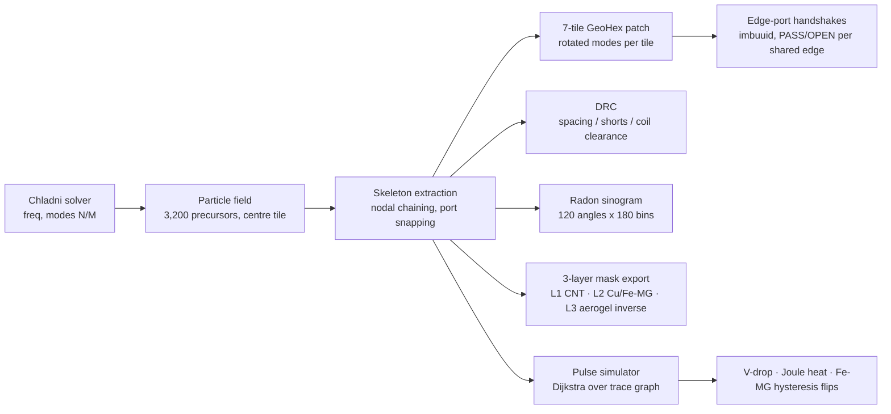

<!-- SOM-DOC-10911-v1.0.0 -->
# icoskin
Icospheric Multi-Shell Smart Compute Skin — funding explorer and interactive simulator for spatially addressed Fe-BMG sensing skin

Live: https://icoskin.somacosf.com/ · CAD/CAM engine: https://icoskin.somacosf.com/cad-cam.html

## Surfaces

| Surface | Source | What it is |
|---|---|---|
| `/` (materials brief) | `app/page.tsx`, `app/Simulator.tsx`, `app/Chladni.tsx`, `lib/ico.ts` | The graded brief: topology math (§1), layers (§2), claim boundary (§3), work packages (§4), fabrication (§5), cymatic mask (§6), core memory (§7), particle sensing (§8), the ask (§9), references (§10), CAD/CAM (§11) |
| `/cad-cam.html` (engine) | `public/cad-cam.html` — single file, no build step | ISM-SCS CAD/CAM Engine v5: the manufacturing workstation the brief's §11 documents |

## CAD/CAM Engine v5 — module map

The engine converges the two earlier single-file prototypes (ISM-SCS hull simulator v4.2 and the Cymatic Chladni & Material Circuit Engine) into one workstation:



1. **Multi-Tile GeoHex Patch Editor** — centre hex + 6 neighbours; each neighbour runs a rotated Chladni mode (N,M offset by axial q,r) so edge continuity is tested, not copied. Shared-edge ports are verified as imbuuid handshakes. Pentagon-defect toggle converts one neighbour to a 5-port tile; its missing edge is flagged as a defect port, never bridged (a closed icosphere has exactly 12 such defects).
2. **Skeletonization & DRC** — nodal samples of |Chladni| below threshold are greedily chained into vector traces, endpoints snapped to edge ports. DRC checks minimum trace spacing (µm, at 50 mm flat-to-flat tile scale), trace–trace shorts, and Fe-MG coil clearance; violations are ringed on canvas and counted.
3. **Tomographic Sinogram & Multi-Layer Exporter** — Radon projection of the centre-tile trace field; exports L1 (CNT scaffold), L2 (Cu/Fe-MG, 0.6× width + coil rings), L3 (inverse field = aerogel infiltration channels) as 1024² PNG masks, plus a stack/netlist JSON with per-tile port tables and imbuuid addressing.
4. **Transient Core-Memory Pulse Simulator** — click two edge ports; Dijkstra routes over the trace graph with mycelial proximity junctions and port launch leads. Per-segment R from material ρ (CNT 1e-5, Cu 1.68e-8, Fe-MG 1.3e-6 Ω·m) at the set trace cross-section; reports path length, total R, V-drop, Joule heat, and flips the hysteresis bit of every Fe-MG coil within 26 px of the path.

## Measured at defaults (N3 M5, 640 Hz, Cu, 120 mA) — verified by driving the shipped file

- Handshakes: **6/12 PASS, 6 OPEN** (open edges name the tile side with no trace endpoint)
- Pulse T0 e0→e3: **18 nodes · 90.4 mm · R 1.88 Ω · ΔV 225 mV · 27.0 mW**
- DRC: **17 trace-crossing shorts, 0 spacing violations** — see bounds

## Honest bounds

- The skeletoniser is greedy chaining (v4 lineage), **not** a true medial-axis transform; its self-crossings are exactly what DRC reports. Medial-axis + Clipper2-class polygon offsetting is the next iteration.
- The sinogram is a Radon projection of the 2D vector field — the correct *input form* for CAL dose planning, not a voxel CT reconstruction.
- Pulse physics is resistive DC per segment (R = ρL/A, P = I²R). Inductive coupling between adjacent Fe-MG coils (SPICE-class transient) is not yet modelled.
- Feasibility grades for the skin itself are unchanged from the brief §3: components TRL 3–5, integrated skin TRL 1–2. The engine is a design/manufacturing tool; it does not raise any TRL by existing.

## Develop / deploy

```bash
npm run build        # static export to out/ (public/cad-cam.html is copied byte-exact)
python3 deploy.py    # git-linked Vercel production deploy of SoMaCoSF/icoskin main
```

Deploy is git-linked: commit + push to `main`, then `deploy.py` creates the production deployment from git and polls to READY. Legacy content is augment-only — new surfaces are added, never overwritten in place without a `.bk` backup.

## Iteration log

- **2026-11-22 · v5 convergence** — CAD/CAM Engine v5 built from the two uploaded posters + v4 prototypes, verified in headless Chrome (zero page errors; pulse/DRC/sinogram/handshakes driven programmatically), converged into this repo as `public/cad-cam.html`, brief gained §11 + header link, engine gained a back-link to the brief. The engine also carries a fallback layout stylesheet, so it renders correctly even where the Tailwind CDN is unreachable.
