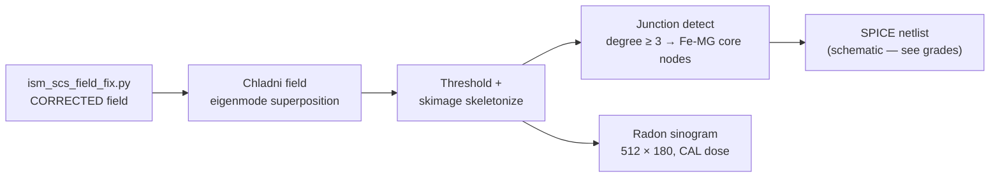

<!-- SOM-DOC-10912-v1.0.0 · engine/ · ISM-SCS Python backend (Tier 3 reference) -->

# ISM-SCS Python Backend Engine — exercised, graded

`ism_scs_engine.py` arrived 2026-11-22 (Gemini-generated, founder-supplied) as the
Tier-3 computational backend of the three-tier stack: field → skeleton → core
nodes → SPICE netlist → CAL sinogram, behind FastAPI. It was **exercised before
integration** (REA protocol), not trusted from its docstrings. Verdicts below are
from runs on this VM (venv: numpy 2.5.5, scikit-image 0.26.0), default tile
`S3:F14:H05`, N5 M3, 432 Hz, 512².



## Grades

| Part | Grade | Evidence |
|---|---|---|
| Radon sinogram (skimage) | **WORKS** | 512×180 dose array, max 254, 1.6 s |
| Skeletonization (skimage `skeletonize`) | **WORKS** | true morphological skeleton |
| Materials table (data) | **DATA** | plausible values; Fe-MG H_c = 1.8 A/m is optimistic vs the published ~44 A/m class figure — treat as placeholder |
| Field as shipped | **BROKEN** | second `cos()` transform moves the nodal set off Z = 0 onto a level set → **0 junctions at every threshold (0.2–0.72), 0 core nodes**, netlist degenerates to 9 lines. Receipt: `as_shipped_receipt.json` |
| Field with `ism_scs_field_fix.py` | **FIXED, MEASURED** | raw superposition: skeleton 3,541 px, **24 core nodes**, 55-line netlist, full compile 2.0 s. Receipt: `examples/S3-F14-H05_receipt.json` |
| SPICE netlist | **SCHEMATIC** | chains core nodes linearly (i → i+1) in dedupe order — it does **not** encode the skeleton graph's actual edges; the ngspice `CORE` model params are unverified against ngspice. A starting shape, not a simulation |
| `logic_role` per node | **PLACEHOLDER** | assigned by `idx % 3`, not by topology or design intent |
| DRC | **ABSENT** | claimed in the module header, not implemented in the Python (DRC lives in the web engine) |
| FastAPI `/compile_tile` | **SHAPE OK** | imports and constructs; not load-tested |

## Run it

```bash
python3 -m venv .venv && .venv/bin/pip install numpy scipy scikit-image fastapi pydantic pillow
.venv/bin/python run_compile.py            # fixed pipeline → examples/
.venv/bin/uvicorn ism_scs_engine:app       # as-shipped API (field bug included — fix first)
```

## The three tiers (target architecture)

1. **Web CAD viewport** (live today): the single-file engine at `/cad-cam` —
   patch editor, skeleton DRC, sinogram, pulse + testbench. React/Three.js
   migration is a port, not a rewrite: the algorithms are the spec.
2. **Desktop shell** (not built): Tauri around tier 1 for filesystem, workers, IPC.
3. **This backend** (reference, exercised): Python scientific stack where JS is
   weak — VAMToolbox-class tomography, Gor'kov solvers, Shapely/Clipper2 DRC,
   ngspice via netlists like the one generated here.

## First knowledge ingestion (2026-11-22)

Founder asked what to ingest first. Answer: **the core-alloy magnetic parameter
set** (H_c, B_s, B_r/B_s, λ_s, S_w) — every surviving claim routes through it
(gate margins, the 8.3 mA drive point, Villari lockup, strain sensing), and the
engine's table carried a wrong placeholder (H_c = 1.8 A/m). Ingested via the
estate Firecrawl connector from manufacturer datasheets into
`knowledge/ism_scs_scraped_knowledge.json`:

- **Metglas 2714A (Co-based)** — logic-core candidate per the Argon fix:
  B_s 0.57 T, λ_s < 0.5 ppm, μ_max 10⁶. Trade: flux reservoir ~2.7× smaller
  than Fe-based — clock restoration even less optional.
- **Metglas 2605SA1 (Fe-based)** — sensing-core candidate: B_s 1.56 T,
  λ_s 27 ppm (the Villari channel), Curie 395 °C.
- H_c is **not** numerically extracted for either (datasheets give curves, not
  tables) — recorded as null with the class figure flagged, not invented.

Notes on the founder-supplied scripts: `outreach.py`'s three target companies
are fictional (`.example` emails, self-awarded fit/patent scores) — a pitch
template, never a send list. `r-nd.py` scrapes arXiv *search pages* and keeps
1,500-char snippets; the ingestion above replaces that pattern with datasheet
scrapes at the source.
