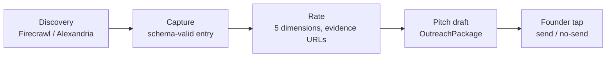

<!-- SOM-DOC-10914-v1.0.0 · outreach/ · vendor capture & rating bucket -->

# Vendor Bucket — capture & rating schema

The founder's `outreach.py` is the **template**: it defines the shape
(`TargetCompany`, `OutreachPackage`) and the intent (capture partners, rate
fit, draft pitches). This directory is that template made into a working
bucket:

- `schema.json` — the contract. A target is not captured until it validates.
- `targets.json` — the bucket itself. **Empty.** The template's three sample
  companies were fictional (`.example` emails); they are not in the bucket.
- `rate.py` — validator + scorer. `fit_score` is a weighted mean of five
  evidence-linked dimensions (capability 0.35, scale 0.20, materials 0.20,
  evidence quality 0.15, reachability 0.10). Placeholder emails and
  un-sourced dimensions are rejected, so the failure mode of the raw
  template — invented companies with self-awarded 9.x scores — cannot recur.

## Flow

Sends stay founder-tapped. The template's patent-novelty paragraph is
excluded from generated packages: novelty assessments are not outreach copy
until they are counsel-grade.

## First fills (queued)

Real candidates whose datasheets are already in `engine/knowledge/`:
Metglas / Hitachi Metals (2714A, 2605SA1 alloys), plus the ingest queue —
micro-toroid fabricators, CNT photopolymer resin makers (μ_ext at 405 nm),
acoustophoretic printing groups.
